# quotes-manager

<!-- coverage:START -->

<!-- coverage:END -->

quotes-manager 2.0.0 absorbs the sc-graph canon explorer into the quote workspace as one Go 1.27 binary, `dist/qm.exe`, over SQLite, DuckDB, and vendored htmx 4.0.0 and cytoscape. The 1.x dual-pane manager keeps its surface at `/`: rune-sorted editable blocks, collections, categories, near-duplicate merge, scoped search, canonical import, and JSON backup and restore. Around it the canon pipeline (`qm all`: sync, parse, load, triangulate, export, report) mirrors bilara, editions, and the dpd dictionary into a published graph database that `qm serve` follows through an atomic pointer swap. A shared nav fronts both UIs, quote citations cross-link into `/texts/{muid}` with a suttacentral fallback, and a `/api/v1` JSON surface covers quotes and canon alike. The server now binds `127.0.0.1:8080` by default instead of `:8080`, the editions source is html-only now that the tex and zip artifact paths are gone, and `qm query --format qm` prints canonical quote blocks straight from the graph. The 1.1.0 tree stays at [v1.1.0](https://github.com/lavantien/quotes-manager/tree/v1.1.0).

## Table of contents

1. [Pictures](#pictures)
2. [Local development](#local-development)
3. [Production environment setup](#production-environment-setup)
4. [Surfaces](#surfaces)
5. [Data and formats](#data-and-formats)
6. [QA harness](#qa-harness)
7. [Build logs](#build-logs)
8. [Architecture and flows](#architecture-and-flows)

## Pictures

1. 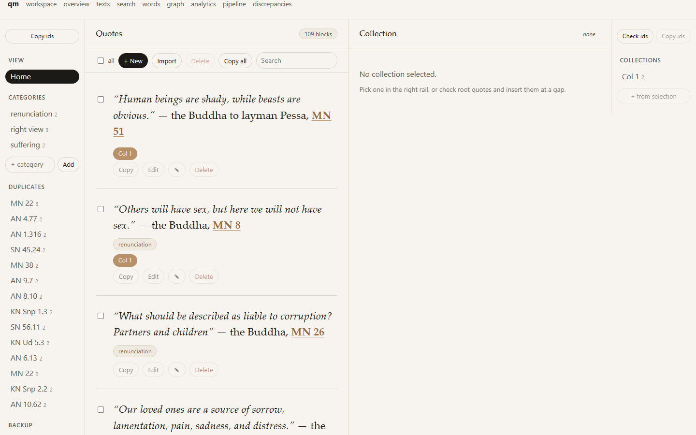

   the quote workspace at `/`, category rail left, rune-sorted corpus in the middle, collections rail right

2. 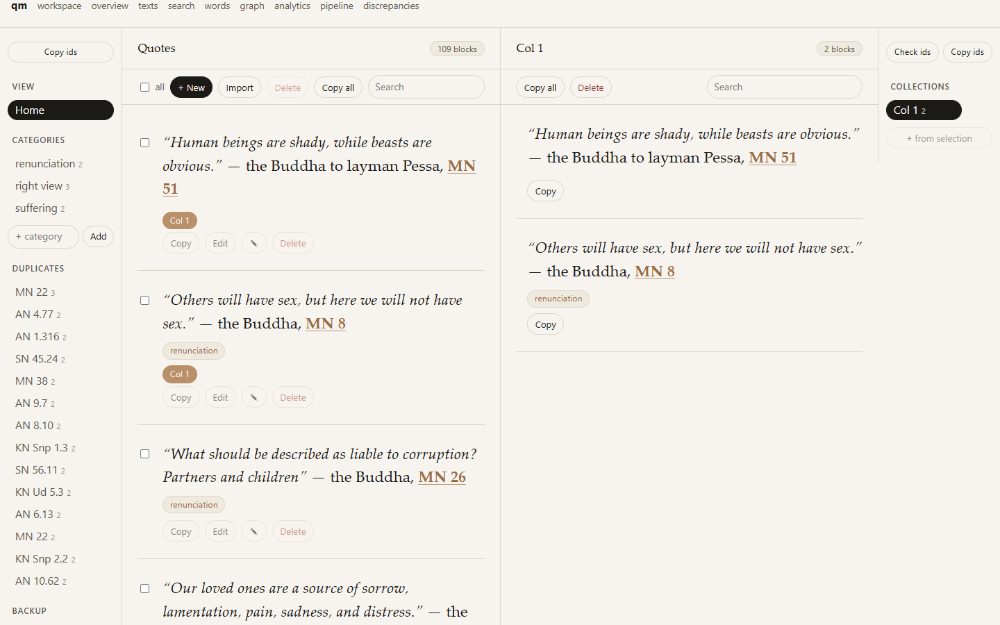

   collection 1 active in the right column, same corpus on the left

3. 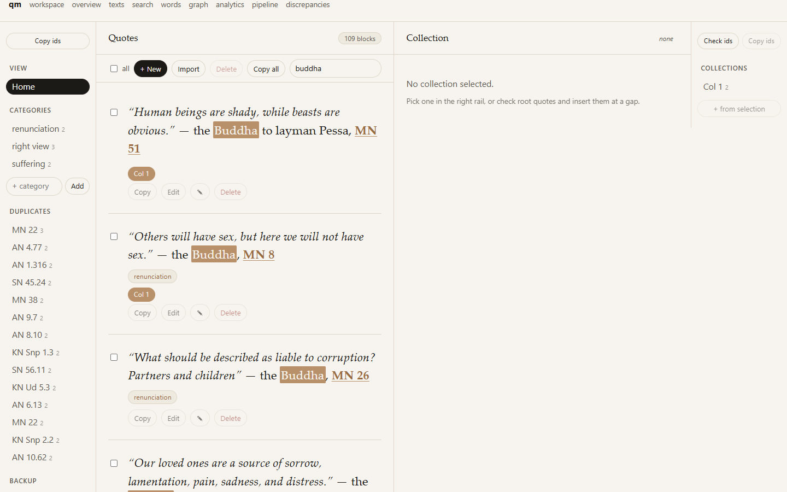

   live search over the corpus with `?rq=buddha`, hits marked in place

4. 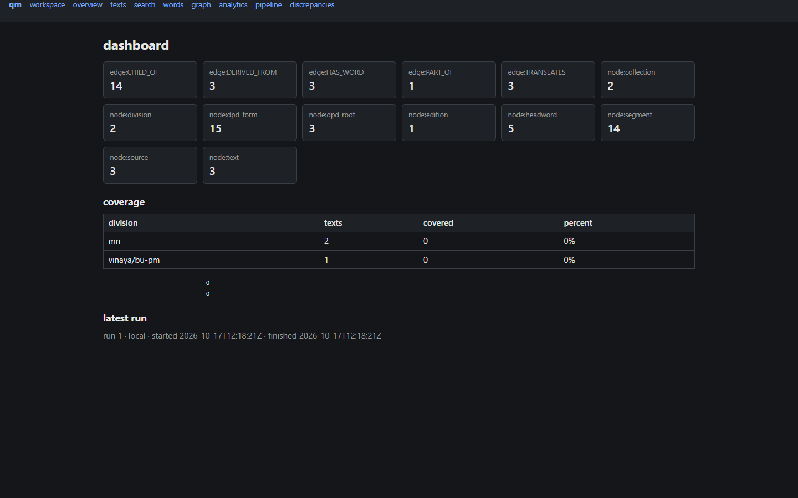

   the canon dashboard, stats grid, coverage by division, latest run and job state

5. 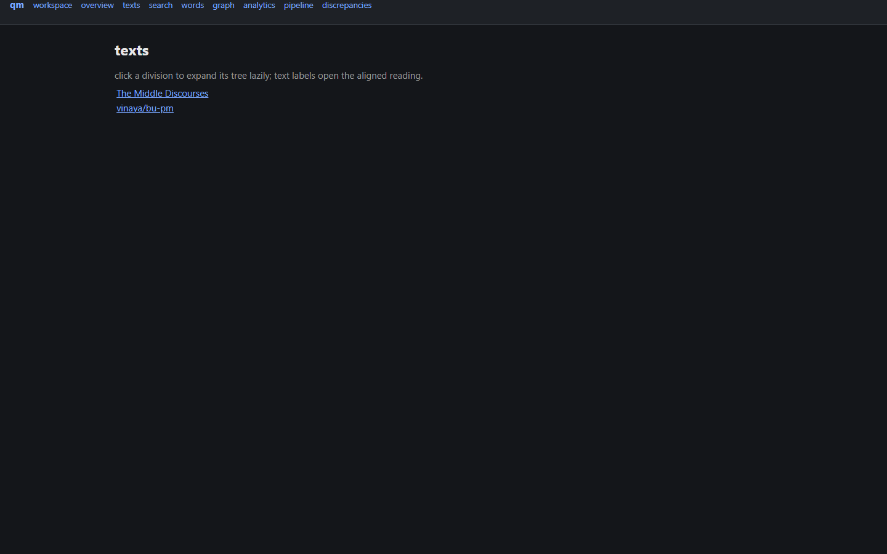

   the text tree at `/texts`

6. 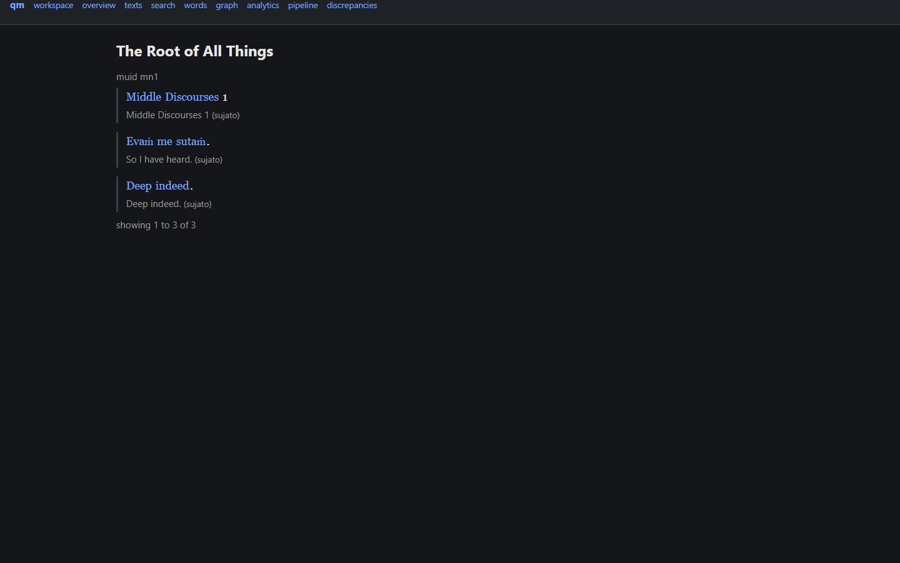

   mn 1 at `/texts/mn1`, aligned pali and english segments

7. 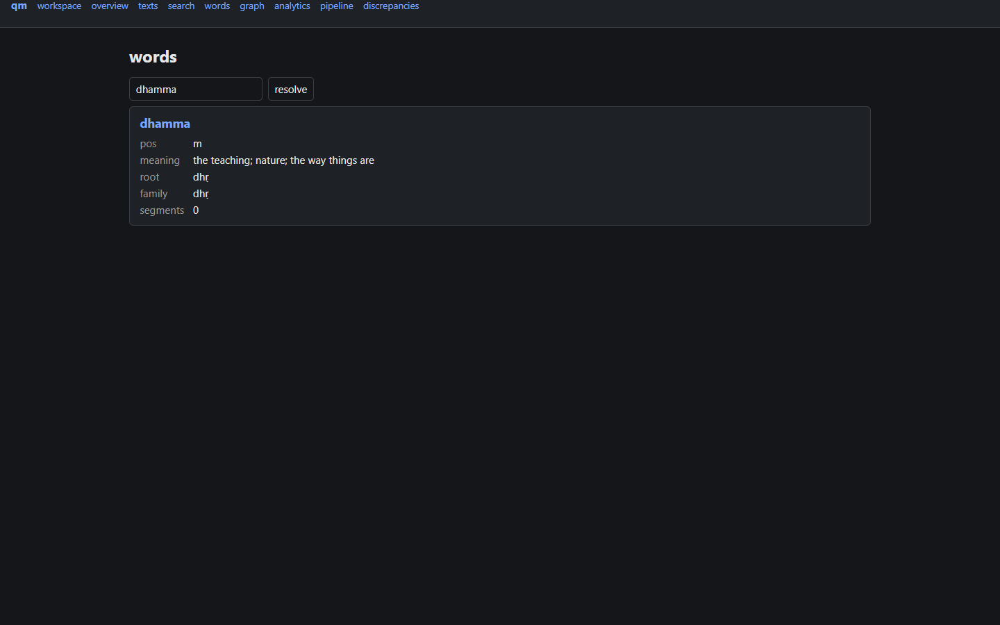

   word lookup at `/words?form=dhamma`, dpd entries with usage refs

8. 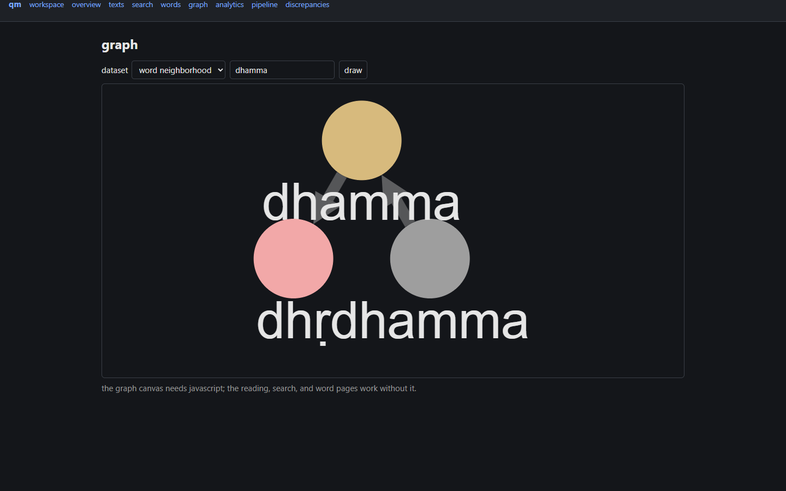

   the word graph at `/graph?dataset=word&param=dhamma`, drawn by cytoscape

`make screenshots` regenerates all eight files. It builds `dist/qm.exe`, serves the seeded quotes app plus a hermetic canon instance in-process, and captures each page at 1440x900 through Chrome or Edge (`QUOTES_BROWSER` overrides the binary). The 1.x `docs/home.png` single shot is retired.

## Local development

Prerequisites: Go 1.27 (`go.mod` pins 1.27.2), a C toolchain for CGO (on Windows the Makefile pins the scoop mingw-winlibs UCRT gcc and exports `CC`/`CXX`), git, Chrome or Edge for screenshots, and Java or Docker for the plantuml diagrams.

1. Clone and build:

```sh
git clone https://github.com/lavantien/quotes-manager
cd quotes-manager
make build
```

`make build` emits `dist/qm.exe` with `CGO_ENABLED=1` and the `sqlite_fts5` tag. Any manual `go` command needs the same treatment: `CGO_ENABLED=1 go build -tags sqlite_fts5 ./cmd/qm`.

2. Run the merged server:

```sh
make run
```

That is `qm serve --addr 127.0.0.1:8080 --db database/quotes.db`. The first run creates and seeds `database/quotes.db` (109 quotes, three sample categories, one sample collection), the seed is never reapplied, edits persist. The workspace is at http://127.0.0.1:8080/ and the canon pages sit beside it. Canon pages answer `503 not ready` until a pipeline run publishes a graph database (next section).

3. Exercise the CLI:

```sh
dist/qm.exe version
dist/qm.exe query quotes --format qm
dist/qm.exe serve --addr 127.0.0.1:9000
```

`query quotes` reads the seeded quotes database offline, the graph subcommands need a published canon database.

4. Regenerate artifacts:

```sh
make extract
make screenshots
make diagrams
```

`make extract` rebuilds `database/seed.sql` and `exports/shortest-first.md` from `dumps/`.

## Production environment setup

1. Config file. `qm` layers built-in defaults, then an optional JSON file (`--config file`, unknown fields rejected), then environment variables. The sections: `quotes` (db_path, dumps_dir, seed_file, export_file, pictures_dir), `server` (addr, default_limit, max_limit, graph_max_nodes, graph_max_edges, job_log_lines, sql_console, analytics_threads, analytics_memory_gb, read, write, idle, and shutdown timeouts), `canon.repos.bilara` and `canon.repos.editions` (url, branch, dir each), `canon.bilara` (root_lang, root_edition, trans_lang, authors, sparse_dirs, keep_regexes, max_range_expansion), `canon.editions` (authors, sparse_dirs, keep_regexes), `canon.dpd` (url, sha256, max_tarball_bytes, max_db_bytes, timeout_seconds, min_token_length, unknown_warn_per_muid), `canon.paths` (data_dir, e2e_dir, dist_dir, db_dir, manifests_dir, reports_dir), `canon.load` (batch_size), `canon.triangulate` (severity map over the 13 check ids, empty_warn_per_muid, similarity_min, detail_sample_max), `canon.e2e` (muids), `canon.export` (parquet).

2. Environment overrides, the complete set the loader honors:

| variable | shape | overrides |
|---|---|---|
| QM_QUOTES_DB_PATH | path | quotes.db_path |
| QM_QUOTES_DUMPS_DIR | path | quotes.dumps_dir |
| QM_QUOTES_SEED_FILE | path | quotes.seed_file |
| QM_QUOTES_EXPORT_FILE | path | quotes.export_file |
| QM_QUOTES_PICTURES_DIR | path | quotes.pictures_dir |
| QM_SERVER_ADDR | host:port | server.addr |
| QM_SERVER_READ_TIMEOUT_SECONDS | int | server.read_timeout_seconds |
| QM_SERVER_WRITE_TIMEOUT_SECONDS | int | server.write_timeout_seconds |
| QM_SERVER_IDLE_TIMEOUT_SECONDS | int | server.idle_timeout_seconds |
| QM_SERVER_SHUTDOWN_TIMEOUT_SECONDS | int | server.shutdown_timeout_seconds |
| QM_CANON_DATA_DIR | path | canon.paths.data_dir |
| QM_CANON_E2E_DIR | path | canon.paths.e2e_dir |
| QM_CANON_DIST_DIR | path | canon.paths.dist_dir |
| QM_CANON_DB_DIR | path | canon.paths.db_dir |
| QM_CANON_MANIFESTS_DIR | path | canon.paths.manifests_dir |
| QM_CANON_REPORTS_DIR | path | canon.paths.reports_dir |
| QM_CANON_DPD_URL | url | canon.dpd.url |
| QM_CANON_DPD_SHA256 | 64 hex | canon.dpd.sha256 |
| QM_CANON_SERVER_DEFAULT_LIMIT | int | server.default_limit |
| QM_CANON_SERVER_MAX_LIMIT | int | server.max_limit |
| QM_CANON_SERVER_GRAPH_MAX_NODES | int | server.graph_max_nodes |
| QM_CANON_SERVER_GRAPH_MAX_EDGES | int | server.graph_max_edges |
| QM_CANON_SERVER_JOB_LOG_LINES | int | server.job_log_lines |
| QM_CANON_SERVER_ANALYTICS_THREADS | int | server.analytics_threads |
| QM_CANON_SERVER_ANALYTICS_MEMORY_GB | int | server.analytics_memory_gb |
| QM_CANON_SERVER_SQL_CONSOLE | bool | server.sql_console |
| QM_CANON_EXPORT_PARQUET | bool | canon.export.parquet |
| QM_CANON_BATCH_SIZE | int | canon.load.batch_size |
| QM_CANON_SIMILARITY_MIN | float 0 to 1 | canon.triangulate.similarity_min |
| QM_CANON_EMPTY_WARN_PER_MUID | int | canon.triangulate.empty_warn_per_muid |
| QM_CANON_E2E_MUIDS | csv | canon.e2e.muids |

3. Loopback default. `server.addr` defaults to `127.0.0.1:8080`. Version 1.x bound `:8080` on every interface, 2.0.0 binds the loopback only, a deliberate behavior change for the merged app. Override with `--addr`, `QM_SERVER_ADDR`, or the `ADDR` make variable.

4. Pipeline and publish. `qm all` (or `make stage STAGE=all`) runs sync, parse, load, triangulate, export, report in order, and `make stage STAGE=parse` runs any single stage through the built binary. `load` writes `database/canon/canon-<runid>.db` then publishes it: `pointer.json` is written to a temp file, fsynced, and renamed over the old pointer, so `serve` follows the new run on the next request without a restart. Superseded `canon-*.db` files and their wal, shm, and journal sidecars are retired, with a retry window when a Windows reader still holds the old file: the pointer already references the new run and a lagging retirement is reported, never silently dropped.

## Surfaces

### the qm cli

Root flags: `--config file` and `-v` (verbose). `qm` with no command prints the registry.

| command | flags | purpose |
|---|---|---|
| qm all | none | sync, parse, load, triangulate, export, report in one run |
| qm sync | --source bilara, editions, dpd, or all | update and prune the mirrors, write the sync manifest |
| qm prune | --source as sync | prune the mirrors without updating |
| qm parse | none | parse the mirrors into ndjson artifacts |
| qm load | none | load the artifacts into a published graph database |
| qm triangulate | none | run all triangulation checks against the current database |
| qm export | none | rebuild the duckdb sidecar from the current database |
| qm report | --out dir | render the triangulation report under a dated dir |
| qm discrepancies | --severity --check --run | list discrepancies, run 0 means latest |
| qm query | see below | query the current database |
| qm serve | --addr --db | serve the api and frontend |
| qm extract | none | dumps to seed sql plus the shortest-first export |
| qm fixture | --db --out | regenerate the clone-of-main test fixture |
| qm screenshot | --out dir | capture the numbered UI journey |
| qm coverage | --profile --readme | refresh the readme coverage badge |
| qm version | none | print version and schema version |

`qm query` takes a subcommand: segments, search, quotes, tree, stats, or word. Shared flags: `--muid`, `--with-en`, `--text`, `--lang` (pali or en), `--limit`, `--offset`, `--division`, `--types`, `--form`, `--headword`, `--segments`, `--format json or qm`. `query quotes` adds `--db` for a database path override and defaults to the qm format, the graph subcommands default to json.

### http routes

One mux serves everything. The inventory below is pinned by the route-registration test in `internal/e2e`.

Workspace routes, the 1.x quote manager:

| method | path | purpose |
|---|---|---|
| GET | / | workspace home, subtree catch-all for unknown GET paths |
| GET | /quotes | root list fragment for htmx swaps |
| GET | /quotes/new | new quote form fragment |
| GET | /quotes/import/form | canonical import textarea |
| POST | /quotes/import | create quotes from a canonical paste |
| POST | /quotes | create a quote with its categories |
| GET | /quotes/{id}/edit | edit form fragment |
| POST | /quotes/{id} | update a quote |
| DELETE | /quotes/{id} | delete a quote |
| POST | /quotes/delete | bulk delete the checked quotes |
| GET | /quotes/{id}/copy | copy one canonical block |
| GET | /quotes/{id}/categories | category chips fragment |
| GET | /quotes/{id}/categories/edit | inline category editor |
| POST | /quotes/{id}/categories | set a quote's categories |
| GET | /export.txt | whole corpus as the canonical export |
| GET | /backup.json | versioned whole-database JSON snapshot |
| POST | /restore | restore a backup, replacing every table |
| GET | /collections/{cid} | collection pane |
| POST | /collections | create a collection from the selection |
| POST | /collections/{cid}/items | prepend selected quotes to a collection |
| POST | /collections/{cid}/insert | insert the selection at a 1-based position |
| POST | /collections/{cid}/rename | rename a collection |
| DELETE | /collections/{cid} | delete a collection |
| POST | /collections/{cid}/reorder | save a drag reorder |
| GET | /collections/{cid}/export.txt | collection canonical export |
| GET | /ids.txt | corpus text ids, sorted, one per line |
| GET | /collections/{cid}/ids.txt | collection text ids |
| GET | /pane/root | root pane fragment |
| GET | /pane/collection | collection pane fragment |
| GET | /pane/check | check-ids workspace pane |
| POST | /check | check pasted ids against the corpus |
| GET | /search/root | filtered root list fragment plus count swap |
| GET | /search/collection | filtered collection list fragment |
| GET | /rail/left | left rail fragment, views and categories |
| GET | /rail/right | right rail fragment, collections |
| POST | /duplicates/{repID}/merge | merge a near-duplicate cluster into its representative |
| GET | /categories/{ctid} | category-filtered root pane |
| GET | /categories/{ctid}/export.txt | category canonical export |
| POST | /categories | create a category |
| POST | /categories/{ctid}/rename | rename a category |
| DELETE | /categories/{ctid} | delete a category |
| GET | /static/ | embedded assets, cache-control 24 h |

Canon pages at root:

| method | path | purpose |
|---|---|---|
| GET | /dashboard | run stats, coverage by division, latest run, job state |
| GET | /texts | text tree root |
| GET | /texts/branch | tree branch fragment |
| GET | /texts/{muid} | text page, aligned pali and english segments |
| GET | /search | canon full-text search |
| GET | /words | word lookup by surface form |
| GET | /words/{lemma} | headword page, dpd entries with usage refs |
| GET | /graph | graph viewer over the word, root, tree, and coverage datasets |
| GET POST | /analytics | analytics tables, query form behind sql_console |
| GET POST | /pipeline | pipeline job runner |
| GET | /discrepancies | discrepancy browser |
| GET | /partials/job/{id} | job status fragment |

The `/api/v1` JSON surface:

| method | path | purpose |
|---|---|---|
| GET | /api/v1/quotes | quote rows with total, limit and offset clamped 50 to 500 |
| GET | /api/v1/quotes/{id} | one quote as JSON, 404 envelope on a miss |
| GET | /api/v1/version | build and schema version |
| GET | /api/v1/stats | corpus stats |
| GET | /api/v1/segments | segment pairs, muid and translation filters, paging |
| GET | /api/v1/search | full-text search over the graph |
| GET | /api/v1/tree | division tree nodes |
| GET | /api/v1/word/form | word lookup by surface form |
| GET | /api/v1/word/headword | word lookup by headword |
| GET | /api/v1/runs | pipeline runs |
| GET | /api/v1/discrepancies | triangulation discrepancies |
| GET | /api/v1/graph/word | word graph edges |
| GET | /api/v1/graph/root | root graph |
| GET | /api/v1/graph/tree | tree graph |
| GET | /api/v1/graph/coverage | coverage graph |
| POST | /api/v1/jobs | start a pipeline job |
| GET | /api/v1/jobs | list jobs |
| GET | /api/v1/jobs/{id} | job status |
| GET | /api/v1/jobs/{id}/logs | job log tail |
| POST | /api/v1/jobs/{id}/cancel | cancel a job |
| GET | /api/v1/analytics/catalog | list the analytics datasets |
| GET | /api/v1/analytics/{name} | dataset rows as JSON |
| GET | /api/v1/analytics/{name}/csv | dataset rows as CSV |
| POST | /api/v1/analytics/query | sql console query, gated by sql_console |
| GET | /api/v1/export | export metadata |
| GET | /api/v1/export/parquet/{table} | parquet file download |
| GET | /api/v1/report | report index |
| GET | /api/v1/report/{date}/{file} | report file |
| GET POST | /api/ | JSON 404 catch-all for unknown api paths |

### make targets

`make help` prints this table from the Makefile comments:

```text
help          show this help
all           run the full test suite (default)
build         build the qm binary into dist/
test          run the full test suite
test-pkg      run one package's tests: make test-pkg PKG=./internal/config
test-one      run one named test: make test-one PKG=./internal/cli TEST=TestLiveEnabled
race          go test -race over the merged-app core (RACE_PKGS)
vet           go vet
fmt           gofumpt all Go files
lint          golangci-lint run
lint-pkg      lint one package: make lint-pkg PKG=./internal/config
typecheck     compile every package, then go vet
sloc          enforce the 1000-line ceiling on every Go file
fuzz          fuzz every target in the repo for FUZZ_TIME each
fuzz-one      fuzz one target: make fuzz-one PKG=./internal/quote FUZZ_TARGET=FuzzParseCanonical
mutate        mutation-test MUTATE_PKGS, every surviving mutant fails the build
memtest       hermetic pipeline + merged e2e under a hard GOMEMLIMIT
e2e-hermetic  merged-app hermetic e2e (internal/e2e + the cli hermetic pass)
e2e           live end-to-end pipeline (network, QM_E2E_LIVE gate)
verify        run the full quality chain, fail-fast
vendor-assets verify or refresh the vendored htmx/cytoscape pins in web/static
diagrams      render every docs/diagrams/*.puml to a committed PNG beside it
stage         run one pipeline stage via the built binary: make stage STAGE=parse
run server    run the web server (http://127.0.0.1:8080)
extract       regenerate database/seed.sql + exports/shortest-first.md from dumps/
seed          delete the database so the next 'make run' re-seeds it
tidy          go mod tidy
clean         remove generated artifacts (database, binaries)
coverage      recompute Go test coverage and refresh the README coverage badge
screenshots   capture the numbered UI journey into project-pictures/ (needs git, Chrome or Edge)
fixture       regenerate the clone-of-main test fixture (internal/store/storetest)
monitor       memory guard over project processes (make monitor MONITOR_FOR=5s)
```

## Data and formats

Canonical quote block, exactly as `exports/shortest-first.md` renders it:

```text
*"Human beings are shady, while beasts are obvious."* - **the Buddha to layman Pessa, MN 51**
```

Every passage line is wrapped in italics, each line but the last carries two trailing spaces as the markdown break, and the final line ends with ` - **citation**` outside the italics. Source curly quotes and pali diacritics are preserved. Consecutive blocks in the export are divided by a three-dot block with two blank lines around it, the first two dots carrying trailing spaces:

```text
.  
.  
.
```

The qm output format. `qm query` takes `--format qm` or `--format json`. The qm format prints the canonical block above, one quote after another with the dot divider, produced by the same renderer as the export. The json format prints raw rows. `query quotes` defaults to qm, the graph subcommands default to json. After a pipeline run:

```sh
dist/qm.exe query segments --muid mn1 --with-en --format qm --limit 6
```

prints:

```text
*Middle Discourses 1 *  
*The Root of All Things *  
*So I have heard. *  
*At one time the Buddha was staying near Ukkaṭṭhā in the Subhaga Forest at the root of a magnificent sal tree. *  
*There the Buddha addressed the mendicants, *  
*“Mendicants!” * - **MN 1**
```

Mirrors and pruning. bilara (`suttacentral/bilara-data`, branch `published`) and editions (`suttacentral/editions`, branch `main`) are git mirrors under `data/repos`. `qm sync` updates each mirror then prunes it in the same pass down to `sparse_dirs` plus `keep_regexes`, and writes the manifest to `docs/canon/manifests/sync.json`. `qm prune` prunes without updating. The dpd source is a tarball, `dpd.db.tar.xz` from the dpd-db latest release or a `file:` url for hermetic runs, fetched under a timeout, checked against the sha256 pin when one is set, capped by `max_tarball_bytes` and `max_db_bytes`, and extracted once into `data/dpd`.

Generated files. `database/seed.sql` and `exports/shortest-first.md` come from `qm extract` over `dumps/`, `database/quotes.db` is gitignored and created on first serve. Never hand-edit generated files.

Attribution. The mirrors and the dpd database carry their own licenses and authors. [docs/attribution.md](docs/attribution.md) records each upstream project and what ships where.

## QA harness

The verification chain runs through make in order, committing at each green step.

| gate | command | 2.0.0 baseline |
|---|---|---|
| full suite | make test | |
| memory | make memtest | |
| format | make fmt | |
| lint | make lint | |
| types | make typecheck | |
| size | make sloc | |
| fuzz | make fuzz | |
| mutation | make mutate | |
| hermetic e2e | make e2e-hermetic | |
| full chain | make verify | |

pending the 2.0.0 baseline run

## Build logs

```text
pending the 2.0.0 baseline run
```

## Architecture and flows

<details>
<summary>architecture and flows</summary>

All seven diagrams lay out left to right. `make diagrams` regenerates them from the committed `docs/diagrams/*.puml` sources with the sha256-pinned plantuml 1.2026.8 jar, java required, and prints a docker fallback command when java is missing.

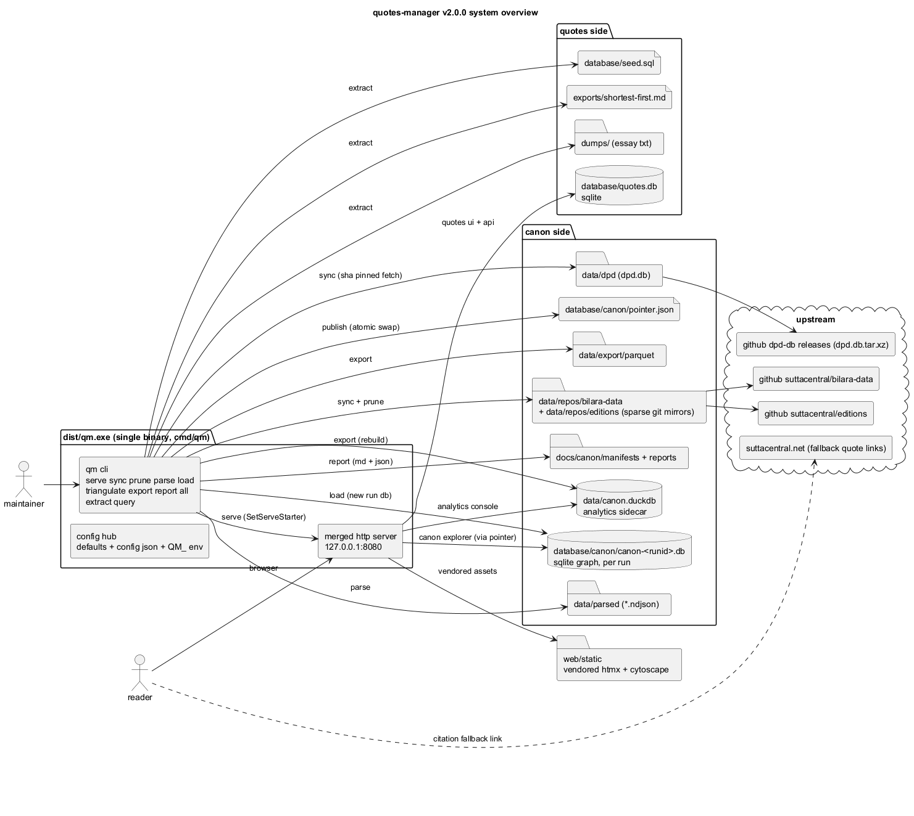

01 the v2.0.0 system overview, one binary over two UIs and three stores

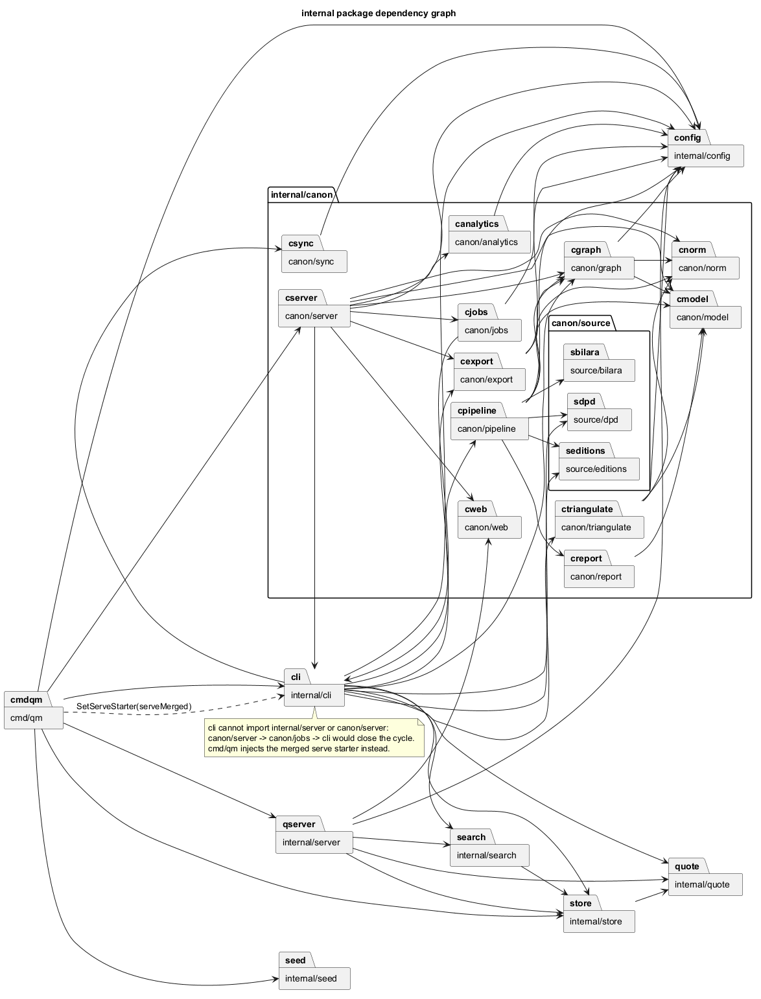

02 the internal package dependency graph

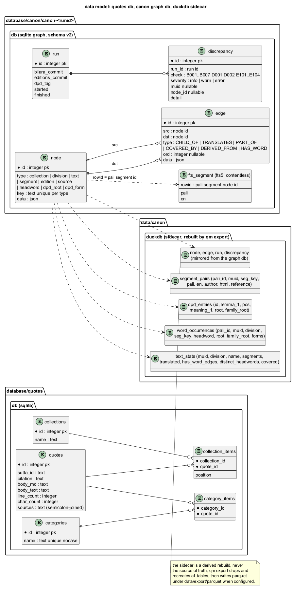

03 the data model, quotes db, canon graph db, duckdb sidecar

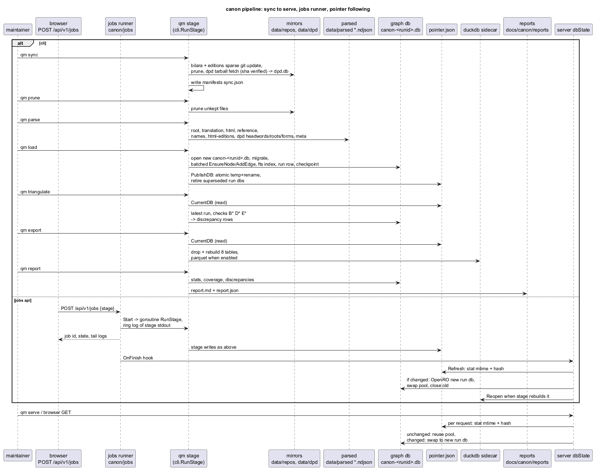

04 the canon pipeline from sync to serve, the jobs runner, pointer following

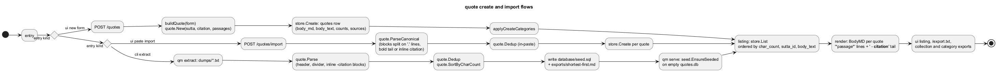

05 the quote create and import flows through the workspace

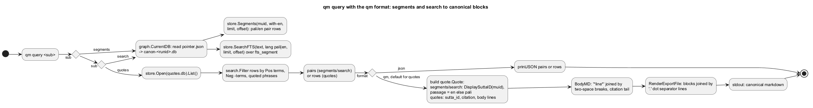

06 qm query with the qm format, segments and search to canonical blocks

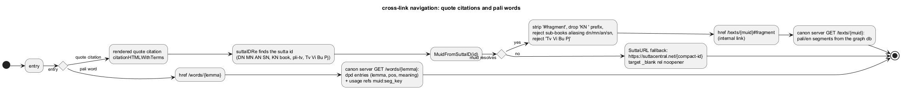

07 cross-link navigation, quote citations and pali words into canon pages

</details>
